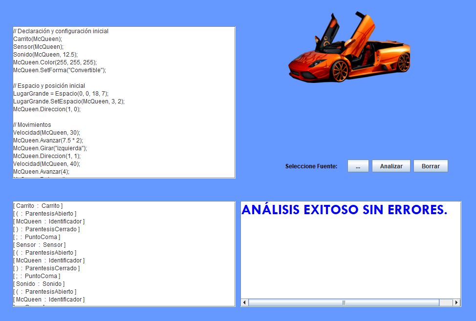

# Carrito · Analizador léxico y sintáctico

Aplicación de escritorio en Java Swing que usa JFlex y Java CUP para mostrar los tokens y validar la sintaxis de un minilenguaje para programar un carrito. El proyecto nació en el curso de Lenguajes Formales y Autómatas de la Universidad Nacional de Trujillo.

Puedes escribir un programa o abrir un archivo de texto, pulsar **Analizar** y ver los tokens y el resultado sintáctico en paneles separados. Los comandos describen acciones del carrito que la aplicación analiza como texto.



## Ejecutar

Necesitas un JDK compatible con Java 8 o posterior y Apache Ant. Desde la raíz del proyecto:

```sh
ant clean run
```

También puedes abrir la carpeta del proyecto en NetBeans como proyecto Java con Ant y pulsar **Ejecutar proyecto**. Ant descarga el runtime de Java CUP desde Maven Central en la primera compilación, por lo que ese paso necesita conexión a Internet.

## Probar un programa

Abre [ejemplos/mcqueen.txt](ejemplos/mcqueen.txt) con el botón **…** y pulsa **Analizar**. También puedes pegar este ejemplo en el editor:

```text
Carrito(McQueen);
McQueen.Color(255, 0, 0);
McQueen.Direccion(1, 0);
Velocidad(McQueen, 30);
McQueen.Avanzar(4);
McQueen.Detener();
```

## Código fuente

- `entrada.jflex` define los tokens que se muestran en la interfaz.
- `entradaCup.jflex` define el lexer que entrega tokens al parser.
- `Grammar.cup` define las reglas sintácticas.
- `Ventana.java` y `Ventana.form` contienen la interfaz Swing.

Los analizadores Java generados están incluidos para compilar y ejecutar el proyecto directamente. Si editas una especificación, regenera su salida durante el desarrollo con JFlex 1.4.3 o Java CUP 0.11a, según corresponda, y actualiza el archivo generado en `src/trabajoimplementacion/`.
